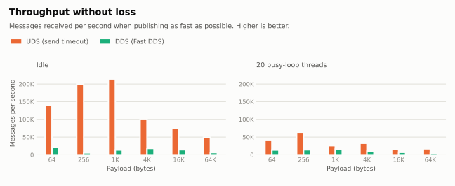

# ros2_uds_ipc

[English](README.md) | [日本語](README_ja.md)

A thin C++ library for ROS 2 that publishes and subscribes `rclcpp` message types as-is over Unix domain
sockets (`AF_UNIX` / `SOCK_SEQPACKET`), bypassing DDS.

## Concept

DDS brings discovery, QoS matching and the RTPS protocol layer. For an event-driven path between two
processes on the same machine that must react the moment a message arrives (e.g. `ros2_control` -> CAN
gateway), that machinery is latency you do not need.

`ros2_uds_ipc` keeps the ROS 2 message types but replaces the transport:

- **Any rosidl message type** — a message is serialized to CDR once and sent with a single `send()`.
  Variable-length messages work.
- **Reliable, boundary-preserving** — `SOCK_SEQPACKET` is connection-oriented and keeps datagram
  boundaries (one `send` = one `recv`), so there is no manual framing and delivery is not best-effort.
- **Never blocks the sender by default** — `publish()` is non-blocking and returns `false` when the peer is
  not connected or its receive queue is full, so a message is never dropped silently. The caller decides
  whether to log or fall back.
- **Optional back-pressure** — `publish(msg, timeout)` waits for a slow subscriber for up to `timeout`
  instead of dropping the message.
- **Automatic reconnection** — either side can be restarted; the publisher reconnects on the next
  `publish()`.
- **No per-message heap allocation** on the hot path (buffers are reused).
- **Optional DDS mirror** — the UDS path is invisible to `ros2 topic echo` and rosbag, so the same CDR
  bytes can also be forwarded to a regular DDS topic for debugging and recording. The DDS publish runs
  on a dedicated thread and only while the mirror topic has subscribers.

The connection is 1:1: one `UdsPublisher` talks to one `UdsSubscriber` through one socket path.

## Requirements

- Linux
- ROS 2 (developed on Jazzy)
- C++17

## Installation

```bash
cd ~/ros2_ws/src
git clone https://github.com/doguto/ros2_uds_ipc.git
cd ~/ros2_ws
colcon build --packages-select ros2_uds_ipc
```

## How to Use

`package.xml`:

```xml
<depend>ros2_uds_ipc</depend>
```

`CMakeLists.txt`:

```cmake
find_package(ros2_uds_ipc REQUIRED)
target_link_libraries(my_node ros2_uds_ipc::ros2_uds_ipc)
```

### Subscriber

The subscriber owns the socket file. It creates the parent directory if needed and removes the file on
destruction.

```cpp
#include <ros2_uds_ipc/uds_subscriber.hpp>

uds_ipc::UdsSubscriber<sensor_msgs::msg::JointState> subscriber(
  "/run/my_robot/joint_command.sock",
  [](const sensor_msgs::msg::JointState & msg) {
    // Called from the subscriber's own thread, not from an rclcpp executor thread.
    // Synchronize access to shared state yourself.
  });
```

The constructor throws `std::runtime_error` if the socket cannot be set up. The third argument,
`max_message_size` (default 65536 bytes), is the largest serialized message that can be received;
anything larger is truncated.

### Publisher

```cpp
#include <ros2_uds_ipc/uds_publisher.hpp>

uds_ipc::UdsPublisher<sensor_msgs::msg::JointState> publisher("/run/my_robot/joint_command.sock");

sensor_msgs::msg::JointState msg;
if (!publisher.publish(msg)) {
  // Not connected (e.g. the subscriber has not started yet) or the subscriber's queue is full.
}

// Wait for up to 10 ms for a slow subscriber instead of dropping the message.
publisher.publish(msg, std::chrono::milliseconds(10));
```

How many messages may wait for the subscriber is bounded by the socket send buffer. The third constructor
argument sets it in bytes (`SO_SNDBUF`; 0 keeps the system default). The kernel clamps it to
`net.core.wmem_max`, so raise that sysctl to go beyond it.

```cpp
uds_ipc::UdsPublisher<sensor_msgs::msg::JointState> publisher(
  "/run/my_robot/joint_command.sock", nullptr, 1024 * 1024);
```

### Mirroring to DDS

Pass a publisher created with `create_uds_mirror()` to either side to make the messages visible to
`ros2 topic echo` and rosbag. Mirrored messages may be delayed by up to 10 ms and are dropped (oldest
first) if DDS cannot keep up, so use the mirror for observation only.

```cpp
#include <ros2_uds_ipc/uds_mirror.hpp>

auto mirror = uds_ipc::create_uds_mirror<sensor_msgs::msg::JointState>(*node, "joint_command");
uds_ipc::UdsPublisher<sensor_msgs::msg::JointState> publisher("/run/my_robot/joint_command.sock", mirror);
```

## Benchmark

Measured with `ros2_uds_ipc_benchmark` (see below): a publisher node and a subscriber node in separate
processes, 6 payload sizes x 4 publish rates, idle and with 20 busy-loop threads competing for the CPU.

- **UDS** — `publish(msg)`, non-blocking
- **UDS (send timeout)** — `publish(msg, 1s)`, waits for the subscriber instead of dropping
- **DDS (Fast DDS)** — a plain `rclcpp` publisher / subscription, reliable + keep-all, default transport

Environment: Intel Core i7-13700H (20 threads), WSL2 (kernel 6.18), ROS 2 Jazzy, `rmw_fastrtps_cpp`.
Each condition was run once, without CPU pinning or real-time scheduling, so differences of a few tens of
microseconds are within run-to-run noise. Raw data: [`docs/benchmark/latency_wsl2_fastdds.csv`](docs/benchmark/latency_wsl2_fastdds.csv).

### Latency

<picture>
  <source media="(prefers-color-scheme: dark)" srcset="docs/benchmark/latency_1khz-dark.svg">
  
</picture>

### Throughput

Publishing as fast as possible, both lossless transports deliver every message; UDS does it 2x - 36x faster.
The backlog also stays short: the median latency in this condition is 55 µs - 3.3 ms over UDS and
169 ms - 1.6 s over DDS. Non-blocking UDS is left out here because it drops messages instead (see below).

<picture>
  <source media="(prefers-color-scheme: dark)" srcset="docs/benchmark/throughput-dark.svg">
  
</picture>

### CPU usage

<picture>
  <source media="(prefers-color-scheme: dark)" srcset="docs/benchmark/cpu_per_message-dark.svg">
  
</picture>

### Message loss

Share of messages that the non-blocking `publish(msg)` reported as not sent (returned `false`), by payload size.
With a send timeout, and over DDS, no message was lost in any condition.

| CPU | Rate | 64 | 256 | 1K | 4K | 16K | 64K |
|---|---|---|---|---|---|---|---|
| Idle | 100 Hz | 0% | 0% | 0% | 0% | 0% | 0% |
| Idle | 1 kHz | 0% | 0% | 0% | 0% | 0% | 0.2% |
| Idle | 10 kHz | 0% | 0% | 0% | 0.5% | 0.7% | 1.3% |
| Idle | Unlimited | 23.6% | 82.0% | 70.6% | 83.4% | 85.8% | 74.7% |
| Loaded | 100 Hz | 0% | 0% | 0% | 0% | 0% | 0% |
| Loaded | 1 kHz | 0% | 0% | 0% | 0.8% | 0.1% | 2.0% |
| Loaded | 10 kHz | 0% | 0% | 0% | 16.7% | 33.5% | 18.9% |
| Loaded | Unlimited | 53.4% | 85.0% | 84.8% | 91.3% | 91.4% | 77.4% |

### Time to connect

From creating the publisher until a subscriber that is already running can be reached
(median over the 24 conditions, with the range in parentheses).

| CPU | UDS | DDS (Fast DDS) |
|---|---|---|
| Idle | 0.2 ms (0.2 - 0.4) | 438 ms (103 - 446) |
| Loaded | 1.0 ms (0.3 - 8.5) | 1566 ms (59 - 1650) |

### Memory

Peak RSS was 27 - 28 MB per process for UDS in every condition. DDS was the same at rates the subscriber can
keep up with, and grew up to 394 MB when messages piled up (64K payload, unlimited rate). Both sides include
an `rclcpp` node, which the benchmark processes use to receive their parameters.

### Running it yourself

The measurement tools live in a separate package, `ros2_uds_ipc_benchmark`, so that nothing from them
is built into `ros2_uds_ipc`. It measures cross-process latency of UDS and of plain DDS pub / sub
under the same conditions, together with the CPU usage and peak memory of the publisher and subscriber
processes, the number of failed publishes and the time to connect, and writes the result as CSV. It can also run under CPU load (`load_threads`).

```bash
colcon build --packages-up-to ros2_uds_ipc_benchmark
source install/setup.bash

# A single condition
ros2 launch ros2_uds_ipc_benchmark latency.launch.py transport:=uds payload_bytes:=1024 count:=10000 rate_hz:=1000.0

# Same, with 8 busy-loop threads competing for the CPU
ros2 launch ros2_uds_ipc_benchmark latency.launch.py transport:=uds payload_bytes:=1024 load_threads:=8

# CPU load x transport x publish rate x payload size (override with LOADS / RATES / SIZES / COUNT / RMWS).
# dds is measured once per installed RMW implementation.
ros2 run ros2_uds_ipc_benchmark run_latency_matrix.sh result.csv

# Render the CSV into charts (needs matplotlib)
ros2 run ros2_uds_ipc_benchmark plot_latency.py result.csv charts/
```

## Tech Stack

- C++17, `rclcpp` (CDR serialization, `GenericPublisher` for the mirror)
- POSIX sockets: `AF_UNIX` + `SOCK_SEQPACKET`, `poll()`
- `ament_cmake`, GoogleTest

## Testing

```bash
colcon test --packages-select ros2_uds_ipc
colcon test-result --verbose
```

## License

[MIT](LICENSE)
