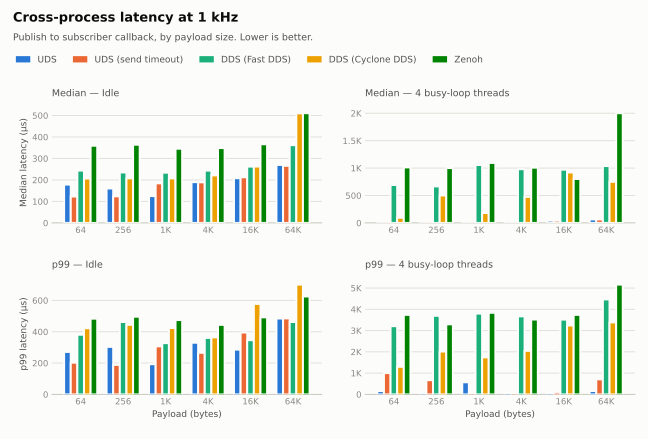

# ros2_uds_ipc

[English](README.md) | [日本語](README_ja.md)

A thin C++ library for ROS 2 that publishes and subscribes `rclcpp` message types as-is over Unix domain
sockets (`AF_UNIX` / `SOCK_SEQPACKET`), bypassing DDS.

<picture>
  <source media="(prefers-color-scheme: dark)" srcset="docs/benchmark/latency_1khz-dark.svg">
  
</picture>

Latency from `publish()` to the subscriber callback between two processes at 1 kHz (lower is better).

- **Under CPU load** (1 KB): the median is 12 - 33 µs for UDS, against 141 - 921 µs for DDS (Fast DDS / Cyclone DDS) and Zenoh.
- **With a real-time priority** (256 B): the largest latency is 27 - 57 µs for UDS, against 95 - 145 µs, and UDS needs
  the priority on a single thread, which is a [constructor argument](#real-time-scheduling).
- **Idle, with the CPU idle states limited to C1** (256 B): the median is 15 - 34 µs for UDS, against 144 - 272 µs.

All the numbers, the measurement setup and how to run the benchmark yourself are in [docs/benchmark.md](docs/benchmark.md).

## Concept

**The problem.** For small messages between two processes on one machine, almost none of the latency is the copy
of the data. It is the layers of the middleware on the receive side, where a message is handed from thread to
thread before the callback runs, and each hand-off is a chance to wait behind other work. Shared memory and
zero-copy only speed up the copy, so this remains.

**The solution.** `ros2_uds_ipc` keeps the ROS 2 message types and addresses this in three ways:

1. **Direct communication over a Unix domain socket.** A dedicated thread waits on the socket and invokes the
   callback itself, with no hand-off between threads.

   ```
   DDS:           kernel -> DDS receive thread -> RTPS processing -> wait set -> executor -> callback
   ros2_uds_ipc:  kernel -> dedicated thread waiting in poll() -> callback
   ```

2. **`SCHED_FIFO` with one constructor argument.** The receive path is a single thread, so giving it a real-time
   priority (and pinning it to a CPU) is enough to keep it from waiting behind other work. No middleware-specific
   configuration is needed (see [Real-time scheduling](#real-time-scheduling)).
3. **No serialization for fixed-size messages.** Messages made only of primitives and fixed-size arrays are sent
   as their in-memory bytes and received straight into the message object.

## Features

`ros2_uds_ipc` keeps the ROS 2 message types but replaces the transport:

- **Any rosidl message type** — a message is serialized to CDR once and sent with a single `send()`.
  Variable-length messages work.
- **No serialization for fixed-size messages** — a message made only of primitives and fixed-size arrays (for
  example `Float64[7]`) is sent as its in-memory bytes and received straight into the message object. This needs
  both ends to be built against the same message definition, which holds on one machine.
- **Reliable, boundary-preserving** — `SOCK_SEQPACKET` is connection-oriented and keeps datagram
  boundaries (one `send` = one `recv`), so there is no manual framing and delivery is not best-effort.
- **Never blocks the sender by default** — `publish()` is non-blocking and returns `false` when the peer is
  not connected or its receive queue is full, so a message is never dropped silently. The caller decides
  whether to log or fall back.
- **Optional back-pressure** — `publish(msg, timeout)` waits for a slow subscriber for up to `timeout`
  instead of dropping the message.
- **Automatic reconnection** — either side can be restarted; the publisher reconnects on the next
  `publish()`.
- **No per-message heap allocation** on the hot path (buffers are reused).
- **Optional DDS mirror** — the UDS path is invisible to `ros2 topic echo` and rosbag, so the same CDR
  bytes can also be forwarded to a regular DDS topic for debugging and recording. The DDS publish runs
  on a dedicated thread and only while the mirror topic has subscribers.

The connection is 1:1: one `UdsPublisher` talks to one `UdsSubscriber` through one socket path.

## Requirements

- Linux
- ROS 2 (developed on Jazzy)
- C++17

## Installation

```bash
cd ~/ros2_ws/src
git clone https://github.com/doguto/ros2_uds_ipc.git
cd ~/ros2_ws
colcon build --packages-select ros2_uds_ipc
```

## How to Use

`package.xml`:

```xml
<depend>ros2_uds_ipc</depend>
```

`CMakeLists.txt`:

```cmake
find_package(ros2_uds_ipc REQUIRED)
target_link_libraries(my_node ros2_uds_ipc::ros2_uds_ipc)
```

### Subscriber

The subscriber owns the socket file. It creates the parent directory if needed and removes the file on
destruction.

```cpp
#include <ros2_uds_ipc/uds_subscriber.hpp>

uds_ipc::UdsSubscriber<sensor_msgs::msg::JointState> subscriber(
  "/run/my_robot/joint_command.sock",
  [](const sensor_msgs::msg::JointState & msg) {
    // Called from the subscriber's own thread, not from an rclcpp executor thread.
    // Synchronize access to shared state yourself.
  });
```

The constructor throws `std::runtime_error` if the socket cannot be set up. The third argument,
`max_message_size` (default 65536 bytes), is the largest serialized message that can be received;
anything larger is truncated.

### Publisher

```cpp
#include <ros2_uds_ipc/uds_publisher.hpp>

uds_ipc::UdsPublisher<sensor_msgs::msg::JointState> publisher("/run/my_robot/joint_command.sock");

sensor_msgs::msg::JointState msg;
if (!publisher.publish(msg)) {
  // Not connected (e.g. the subscriber has not started yet) or the subscriber's queue is full.
}

// Wait for up to 10 ms for a slow subscriber instead of dropping the message.
publisher.publish(msg, std::chrono::milliseconds(10));
```

How many messages may wait for the subscriber is bounded by the socket send buffer. The third constructor
argument sets it in bytes (`SO_SNDBUF`; 0 keeps the system default). The kernel clamps it to
`net.core.wmem_max`, so raise that sysctl to go beyond it.

```cpp
uds_ipc::UdsPublisher<sensor_msgs::msg::JointState> publisher(
  "/run/my_robot/joint_command.sock", nullptr, 1024 * 1024);
```

### Mirroring to DDS

Pass a publisher created with `create_uds_mirror()` to either side to make the messages visible to
`ros2 topic echo` and rosbag. Mirrored messages may be delayed by up to 10 ms and are dropped (oldest
first) if DDS cannot keep up, so use the mirror for observation only.

```cpp
#include <ros2_uds_ipc/uds_mirror.hpp>

auto mirror = uds_ipc::create_uds_mirror<sensor_msgs::msg::JointState>(*node, "joint_command");
uds_ipc::UdsPublisher<sensor_msgs::msg::JointState> publisher("/run/my_robot/joint_command.sock", mirror);
```

### Real-time scheduling

By default the receive thread is an ordinary thread. When the CPU is busy with other work (image processing,
planning), it waits its turn like any other, which shows up as a tail of late callbacks. For the few
subscribers that have a deadline, you can run the receive thread as `SCHED_FIFO` and optionally pin it to a CPU:

```cpp
uds_ipc::Scheduling scheduling;
scheduling.rt_priority = 40;  // 1 - 49, 0 (default) leaves it to the OS
scheduling.cpu = -1;          // a CPU number to pin to, -1 for any
scheduling.require = false;   // true: throw instead of warning when the OS refuses

uds_ipc::UdsSubscriber<sensor_msgs::msg::JointState> subscriber(
  "/run/my_robot/joint_command.sock", callback, 65536, nullptr, scheduling);
if (!subscriber.scheduling_applied()) { /* the OS refused; running with the default scheduling */ }
```

| Do | Don't |
|---|---|
| Use it only for the one or two subscribers that have a deadline (e.g. motor commands) | Put every subscriber on `SCHED_FIFO` |
| Keep the callback short: copy the data and return | Block, allocate or take a lock that normal threads also take (priority inversion) |
| Use 30 - 49 | Expect more from a higher number. Priorities of 50 and above are rejected: Linux runs its interrupt handler threads at 50, and the receive thread must never get ahead of the kernel |
| Pin to a CPU only if it is kept free of other work (`isolcpus`, cpuset) | Pin to a shared core |

The OS must allow it, otherwise a warning is logged and the thread keeps the default scheduling
(`require = true` makes the constructor throw instead). Either:

- add `@realtime - rtprio 49` and `@realtime - memlock unlimited` to `/etc/security/limits.d/99-realtime.conf`,
  and put the user in the `realtime` group (log in again), or
- `LimitRTPRIO=49` in the systemd unit, or `--cap-add=SYS_NICE --ulimit rtprio=49` in Docker.

The publishing thread is yours: if it runs the control loop, give it a real-time priority the same way
(`pthread_setschedparam`). `mlockall(MCL_CURRENT | MCL_FUTURE)` at start-up avoids page faults on that path.

## Tech Stack

- C++17, `rclcpp` (CDR serialization, `GenericPublisher` for the mirror)
- POSIX sockets: `AF_UNIX` + `SOCK_SEQPACKET`, `poll()`
- `ament_cmake`, GoogleTest

## Testing

```bash
colcon test --packages-select ros2_uds_ipc
colcon test-result --verbose
```

## License

[MIT](LICENSE)
