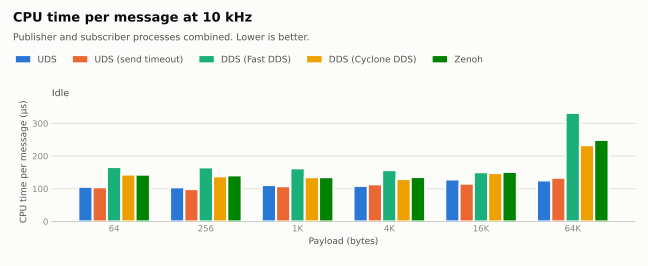

# ros2_uds_ipc

[English](README.md) | [日本語](README_ja.md)

`rclcpp` のメッセージ型を、DDS を経由せずに Unix ドメインソケット (`AF_UNIX` / `SOCK_SEQPACKET`) 上で
そのまま publish / subscribe するための、ROS 2 向けの薄い C++ ライブラリです。

## Concept

DDS には discovery、QoS マッチング、RTPS プロトコル層が付いてきます。同一マシン上の 2 プロセス間で
「メッセージが来たら即反応する」イベント駆動の経路 (例: `ros2_control` -> CAN ゲートウェイ) では、
これらは不要な遅延になります。

### 遅延はどこで生まれるか

publisher がメッセージを渡してから subscriber のコールバックが呼ばれるまでの経路は、4 つの区間に分けられます。

| 区間 | 内容 |
|---|---|
| 1. シリアライズ | ROS のメッセージを CDR のバイト列にする |
| 2. データの運搬 | バイト列を送信側プロセスから受信側プロセスへ移す |
| 3. 受信側の起床 | 待機している受信スレッドをカーネルが起こし、CPU に載せる |
| 4. ミドルウェアの層 | RTPS 処理 -> DDS 受信スレッド -> wait set -> executor -> コールバック |

数十〜数百バイトの指令では、2 のコピーにかかる時間はわずかで、遅延のほとんどは 3 と 4 で生まれます。
共有メモリやゼロコピーは 2 を速くする仕組みなので、これらを使っても 3 と 4 はそのまま残ります。

### ros2_uds_ipc が省く部分

```
DDS:           カーネル -> DDS 受信スレッド -> RTPS 処理 -> wait set -> executor -> コールバック
ros2_uds_ipc:  カーネル -> poll() で待つ専用スレッド -> コールバック
```

- **4 をまるごと省きます。** カーネルが起こした受信スレッドが、そのままデシリアライズしてコールバックを呼びます。
  スレッド間の受け渡しはありません。
- **2 はカーネルを介したコピーだけです。** 小さいメッセージでは無視できる大きさです。
- **1 は残ります。** 任意の rosidl 型 (可変長を含む) を扱うために CDR を使います。DDS も同じコストを払っています。
- **3 は残ります。** スケジューラと CPU の省電力状態で決まる部分で、ライブラリの外
  (リアルタイムスケジューリング、CPU 固定など) で対処する領域です。

### 特徴

`ros2_uds_ipc` は ROS 2 のメッセージ型はそのままに、トランスポートだけを置き換えます。

- **任意の rosidl メッセージ型** — メッセージを CDR に一度シリアライズし、1 回の `send()` で送ります。
  可変長メッセージも扱えます。
- **到達保証・境界保持** — `SOCK_SEQPACKET` は接続指向でデータグラム境界を保持します
  (1 回の `send` = 1 回の `recv`)。手動のフレーミングは不要で、ベストエフォートではありません。
- **デフォルトでは送信側をブロックしない** — `publish()` はノンブロッキングで、未接続または subscriber の
  受信キューが満杯のときは `false` を返します。メッセージが黙って捨てられることはありません。
  ログ出力やフォールバックは呼び出し側が判断します。
- **バックプレッシャー (任意)** — `publish(msg, timeout)` は、遅い subscriber を最大 `timeout` まで待ち、
  メッセージを捨てずに送ります。
- **自動再接続** — どちら側も再起動できます。publisher は次の `publish()` で再接続します。
- **メッセージごとのヒープ確保なし** — ホットパスではバッファを使い回します。
- **DDS へのミラー (任意)** — UDS の経路は `ros2 topic echo` や rosbag から見えないため、同じ CDR
  バイト列を通常の DDS トピックにも流せます。デバッグ・記録用です。DDS への publish は専用スレッドで
  行い、ミラートピックに購読者がいるときだけ動きます。

接続は 1:1 です。1 つのソケットパスにつき、1 つの `UdsPublisher` と 1 つの `UdsSubscriber` が通信します。

## Requirements

- Linux
- ROS 2 (Jazzy で開発)
- C++17

## Installation

```bash
cd ~/ros2_ws/src
git clone https://github.com/doguto/ros2_uds_ipc.git
cd ~/ros2_ws
colcon build --packages-select ros2_uds_ipc
```

## How to Use

`package.xml`:

```xml
<depend>ros2_uds_ipc</depend>
```

`CMakeLists.txt`:

```cmake
find_package(ros2_uds_ipc REQUIRED)
target_link_libraries(my_node ros2_uds_ipc::ros2_uds_ipc)
```

### Subscriber

ソケットファイルは subscriber が所有します。親ディレクトリが無ければ作成し、破棄時にファイルを削除します。

```cpp
#include <ros2_uds_ipc/uds_subscriber.hpp>

uds_ipc::UdsSubscriber<sensor_msgs::msg::JointState> subscriber(
  "/run/my_robot/joint_command.sock",
  [](const sensor_msgs::msg::JointState & msg) {
    // rclcpp の executor スレッドではなく, subscriber 自身のスレッドから呼ばれる.
    // 共有状態に触る場合は呼び出し側で排他すること.
  });
```

ソケットを準備できなかった場合、コンストラクタは `std::runtime_error` を投げます。第 3 引数の
`max_message_size` (既定値 65536 バイト) は受信できるシリアライズ済みメッセージの最大サイズで、
これを超える分は切り捨てられます。

### Publisher

```cpp
#include <ros2_uds_ipc/uds_publisher.hpp>

uds_ipc::UdsPublisher<sensor_msgs::msg::JointState> publisher("/run/my_robot/joint_command.sock");

sensor_msgs::msg::JointState msg;
if (!publisher.publish(msg)) {
  // 未接続 (subscriber がまだ起動していない等) か, subscriber の受信キューが満杯.
}

// 遅い subscriber を最大 10 ms 待ち, メッセージを捨てずに送る.
publisher.publish(msg, std::chrono::milliseconds(10));
```

subscriber 待ちで溜められるメッセージ量は、ソケットの送信バッファで決まります。コンストラクタの第 3 引数で
バイト数を指定できます (`SO_SNDBUF`。0 はシステムのデフォルト)。カーネルが `net.core.wmem_max` に丸めるので、
それを超える値にするには sysctl 側も上げてください。

```cpp
uds_ipc::UdsPublisher<sensor_msgs::msg::JointState> publisher(
  "/run/my_robot/joint_command.sock", nullptr, 1024 * 1024);
```

### DDS へのミラー

`create_uds_mirror()` で作った publisher をどちらかの側に渡すと、メッセージが `ros2 topic echo` や
rosbag から見えるようになります。ミラーされたメッセージは最大 10 ms 遅れることがあり、DDS 側が
追いつかない場合は古いものから捨てられるので、観測用途にのみ使ってください。

```cpp
#include <ros2_uds_ipc/uds_mirror.hpp>

auto mirror = uds_ipc::create_uds_mirror<sensor_msgs::msg::JointState>(*node, "joint_command");
uds_ipc::UdsPublisher<sensor_msgs::msg::JointState> publisher("/run/my_robot/joint_command.sock", mirror);
```

## Benchmark

`ros2_uds_ipc_benchmark` パッケージで計測しました。publisher ノードと subscriber ノードを別プロセスで起動し、
ペイロード 6 種を、無負荷と、busy loop スレッド 4 本と CPU を奪い合う状態の両方で測っています。

- **UDS (send timeout)** — `publish(msg, 1s)`。受信キューが満杯のとき、メッセージを捨てずに subscriber を待ちます。
  満杯にならないレートでは、ノンブロッキングの `publish(msg)` も同じ性能です。
- **DDS (Fast DDS)** / **DDS (Cyclone DDS)** — 通常の `rclcpp` publisher / subscription を `rmw_fastrtps_cpp` /
  `rmw_cyclonedds_cpp` で。reliable + keep-all、トランスポートはデフォルト
- **Zenoh** — 同じ構成を `rmw_zenoh_cpp` で。ローカルの `rmw_zenohd` ルーター経由

環境: Intel Core i5-3427U (4 スレッド)、Linux 7.0.0-31-generic、ROS 2 Jazzy。
グラフは各条件 5 回の実行の中央値です。CPU 固定やリアルタイムスケジューリングは行っていません。

他の送信レート・メッセージの取りこぼし・接続時間・メモリ・生データ・自分で計測する手順は
[docs/benchmark_ja.md](docs/benchmark_ja.md) にあります。

### レイテンシ

<picture>
  <source media="(prefers-color-scheme: dark)" srcset="docs/benchmark/latency_1khz-dark.svg">
  
</picture>

### CPU 使用量

<picture>
  <source media="(prefers-color-scheme: dark)" srcset="docs/benchmark/cpu_per_message-dark.svg">
  
</picture>

## Tech Stack

- C++17、`rclcpp` (CDR シリアライズ、ミラー用の `GenericPublisher`)
- POSIX ソケット: `AF_UNIX` + `SOCK_SEQPACKET`、`poll()`
- `ament_cmake`、GoogleTest

## Testing

```bash
colcon test --packages-select ros2_uds_ipc
colcon test-result --verbose
```

## License

[MIT](LICENSE)
